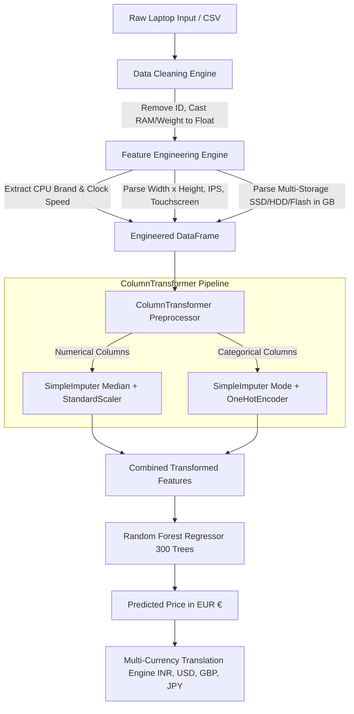

# 💻 Laptop Price Prediction AI System 

[](https://www.python.org/)
[](https://scikit-learn.org/)
[](https://fastapi.tiangolo.com/)
[](https://streamlit.io/)
[](https://reactjs.org/)
[](https://vitejs.dev/)
[](LICENSE)

An end-to-end Machine Learning ecosystem that accurately estimates laptop market valuations based on hardware specifications. The project features automated data cleaning, regex-driven feature engineering, ensemble regression modeling, an asynchronous **FastAPI** backend, a modern **React.js + Vite** single-page application, and an interactive **Streamlit** analytics dashboard with real-time multi-currency conversion.

PROJECT LIVE LINK : [ https://laptop-price-prediction746.streamlit.app ]

---

## 📑 Table of Contents

- [1. Problem Statement](#1-problem-statement)
- [2. Proposed Solution](#2-proposed-solution)
- [3. Dataset & Data Types](#3-dataset--data-types)
  - [Raw Data Schema](#raw-data-schema)
  - [Cleaned & Engineered Features](#cleaned--engineered-features)
- [4. Processing Logic & Pipeline Architecture](#4-processing-logic--pipeline-architecture)
  - [Data Cleaning Logic](#data-cleaning-logic)
  - [Feature Engineering Logic](#feature-engineering-logic)
  - [Preprocessing Pipeline](#preprocessing-pipeline)
- [5. Machine Learning Models & Evaluation](#5-machine-learning-models--evaluation)
  - [Algorithms Trained](#algorithms-trained)
  - [Performance Comparison](#performance-comparison)
  - [Why Random Forest is the Best Model](#why-random-forest-is-the-best-model)
- [6. Application Architecture & Interfaces](#6-application-architecture--interfaces)
  - [Streamlit Web Application](#streamlit-web-application)
  - [FastAPI Backend Service](#fastapi-backend-service)
  - [React.js Frontend Client](#reactjs-frontend-client)
- [7. How to Run & Setup Guide](#7-how-to-run--setup-guide)
  - [Prerequisites](#prerequisites)
  - [Installation](#installation)
  - [1. Train & Evaluate Models](#1-train--evaluate-models)
  - [2. Run the Streamlit Dashboard](#2-run-the-streamlit-dashboard)
  - [3. Run the FastAPI Backend](#3-run-the-fastapi-backend)
  - [4. Run the React.js Frontend](#4-run-the-reactjs-frontend)
  - [5. Run Automated Tests](#5-run-automated-tests)
- [8. Repository Structure](#8-repository-structure)
- [9. Tech Stack Summary](#9-tech-stack-summary)

---

## 1. Problem Statement

Evaluating the fair retail value of a laptop is a complex challenge for consumers, tech reviewers, and e-commerce platforms because:

1. **High Feature Multidimensionality**: A laptop's price is influenced by simultaneous non-linear interactions across CPUs, GPUs, RAM generations, SSD/HDD storage tiers, screen resolutions, display types (IPS, Touchscreen, Retina, 4K), operating systems, and chassis weights.
2. **Compound Text Specifications**: Manufacturer data is typically unstructured or compounded (e.g., `"128GB SSD + 1TB HDD"`, `"IPS Panel Retina Display 2880x1800"`, `"Intel Core i7 7700HQ 2.8GHz"`), making direct tabular modeling impossible without sophisticated text feature extraction.
3. **Market Price Asymmetry**: Non-linear price spikes occur in premium segments (e.g., ultra-light carbon chassis, high-end dedicated GPUs, Apple M-series/Retina lineups) that simple linear baselines cannot capture.

---

## 2. Proposed Solution

This project solves laptop valuation by providing an **intelligent, automated valuation platform**:

- **Automated Text Extraction Pipeline**: Regex-based transformers extract granular hardware metrics (Clock frequency in GHz, Screen Width/Height, Touchscreen/IPS binary flags, SSD/HDD/Flash/Hybrid storage capacities in GB).
- **Ensemble ML Pipeline**: Scikit-Learn ColumnTransformer + Random Forest Regressor trained on historical market data, achieving high predictive accuracy ($\mathbf{R^2 \approx 0.86}$).
- **Multi-Currency Valuation**: Predicts in baseline Euros (`EUR €`) and dynamically translates prices into `INR (₹)`, `USD ($)`, `GBP (£)`, `CAD ($)`, `AUD ($)`, and `JPY (¥)`.
- **Three-Tier Service Architecture**:
  1. **Streamlit App**: Ready-to-use analytical web app with hardware presets, interactive charts, and batch CSV processing.
  2. **FastAPI API**: Production-grade async REST API with Pydantic validation and Swagger documentation.
  3. **React.js + Vite UI**: Fast, responsive web interface communicating with the FastAPI prediction endpoint.

---

## 3. Dataset & Data Types

The model is trained on a comprehensive historical laptop market dataset (`data/raw/laptop_price.csv` and `data/processed/laptop_price_cleaned.csv`).

### Raw Data Schema

| Column Name | Data Type | Description & Example Values |
|---|---|---|
| `laptop_ID` | Integer | Unique identifier (`1`, `2`, `3`) *(removed during preprocessing)* |
| `Company` | String / Categorical | Manufacturer brand (`Apple`, `Dell`, `Lenovo`, `HP`, `Asus`, `Acer`, `MSI`, `Toshiba`, etc.) |
| `Product` | String / Text | Model/series name (`MacBook Pro`, `Inspiron 3567`, `ThinkPad T470`, `ROG GL553VE`) |
| `TypeName` | String / Categorical | Chassis form factor (`Notebook`, `Ultrabook`, `Gaming`, `2 in 1 Convertible`, `Workstation`, `Netbook`) |
| `Inches` | Float | Screen diagonal size in inches (`13.3`, `14.0`, `15.6`, `17.3`) |
| `ScreenResolution` | String / Text | Display resolution & panel technologies (`IPS Panel Retina Display 2560x1600`, `Full HD 1920x1080`, `Touchscreen 1366x768`, `4K Ultra HD 3840x2160`) |
| `Cpu` | String / Text | Processor brand, model, and clock frequency (`Intel Core i5 7200U 2.5GHz`, `Intel Core i7 7700HQ 2.8GHz`, `AMD Ryzen 5 2500U 2GHz`) |
| `Ram` | String / Text | Memory with unit suffix (`"8GB"`, `"16GB"`, `"4GB"`, `"32GB"`) |
| `Memory` | String / Text | Primary and secondary storage configurations (`"256GB SSD"`, `"128GB SSD + 1TB HDD"`, `"500GB HDD"`, `"512GB SSD + 2TB HDD"`) |
| `Gpu` | String / Categorical | Graphics processor unit (`Intel HD Graphics 620`, `Nvidia GeForce GTX 1060`, `AMD Radeon 530`, `Nvidia Quadro M1200`) |
| `OpSys` | String / Categorical | Operating system (`Windows 10`, `macOS`, `Linux`, `No OS`, `Chrome OS`, `Windows 7`, `Mac OS X`) |
| `Weight` | String / Text | Weight with unit suffix (`"1.86kg"`, `"2.5kg"`, `"1.37kg"`) |
| `Price_euros` | Float / Continuous | **Target Variable**: Historical retail price in Euros (`1339.69`, `749.00`, `2499.00`) |

### Cleaned & Engineered Features

| Engineered Feature | Data Type | Extraction Logic & Purpose |
|---|---|---|
| `Ram` | Float (Numeric) | Stripped `"GB"` suffix $\rightarrow$ `8.0`, `16.0`, `32.0` |
| `Weight` | Float (Numeric) | Stripped `"kg"` suffix $\rightarrow$ `1.86`, `2.50`, `1.37` |
| `CPU_Brand` | Categorical (String) | Regex-classified vendor (`Intel`, `AMD`, `Samsung`, `Other`) |
| `CPU_Speed` | Float (Continuous) | Regex parsed clock rate in GHz (e.g. `2.5`, `2.8`, `1.8`) |
| `Screen_Width` | Integer (Discrete) | Horizontal pixel count extracted via regex `(\d+)x(\d+)` (e.g. `1920`, `2560`, `3840`) |
| `Screen_Height` | Integer (Discrete) | Vertical pixel count extracted via regex `(\d+)x(\d+)` (e.g. `1080`, `1600`, `2160`) |
| `Touchscreen` | Binary (`0` or `1`) | Flag indicating capacitive touch support |
| `IPS` | Binary (`0` or `1`) | Flag indicating In-Plane Switching panel technology |
| `SSD_GB` | Float (Numeric) | Total Solid State Drive storage in GB (`0`, `128`, `256`, `512`, `1024`, `2048`) |
| `HDD_GB` | Float (Numeric) | Total Hard Disk Drive storage in GB (`0`, `500`, `1024`, `2048`) |
| `Flash_GB` | Float (Numeric) | Total Flash/eMMC storage in GB (`0`, `32`, `64`, `128`) |
| `Hybrid_GB` | Float (Numeric) | Total Hybrid SSHD storage in GB (`0`, `1000`) |

---

## 4. Processing Logic & Pipeline Architecture



### Data Cleaning Logic (`src/data_cleaning.py`)
- Deduplication: Drops duplicate records to prevent over-represented hardware specs.
- Index pruning: Removes arbitrary database IDs (`laptop_ID`).
- String-to-number transformation: Cleans numeric values formatted with textual units (`"16GB"` $\rightarrow$ `16.0`, `"2.1kg"` $\rightarrow$ `2.1`).

### Feature Engineering Logic (`src/feature_engineering.py`)
- **Processor Parsing**: Uses regular expressions to extract clock frequencies in GHz (`(\d+(?:\.\d+)?)GHz`) and clusters processor manufacturers.
- **Display Resolution & Panel Parsing**: Extracts exact horizontal and vertical dimensions (`(\d+)x(\d+)`) and creates boolean indicator features for `Touchscreen` and `IPS` panel flags.
- **Storage Disaggregation**: Complex storage descriptions with multi-drive setups (e.g. `"256GB SSD + 1TB HDD"`) are split on `"+"`. TB units are converted to GB ($\text{TB} \times 1024$), and storage is mapped into independent columns (`SSD_GB`, `HDD_GB`, `Flash_GB`, `Hybrid_GB`).

### Preprocessing Pipeline (`src/train_model.py`)
- **Numerical Features** (`Inches`, `Ram`, `Weight`, `CPU_Speed`, `Screen_Width`, `Screen_Height`, `Touchscreen`, `IPS`, `SSD_GB`, `HDD_GB`, `Flash_GB`, `Hybrid_GB`): Imputed with `median` strategy and scaled with `StandardScaler()`.
- **Categorical Features** (`Company`, `Product`, `TypeName`, `Cpu`, `ScreenResolution`, `Memory`, `Gpu`, `OpSys`, `CPU_Brand`): Imputed with `most_frequent` strategy and encoded with `OneHotEncoder(handle_unknown="ignore")`.
- Packaged inside a scikit-learn `Pipeline` to ensure zero data leakage between training and inference.

---

## 5. Machine Learning Models & Evaluation

### Algorithms Trained

5 distinct regression algorithms were trained and benchmarked using an 80/20 train/test split and verified with **5-Fold Cross-Validation**:

1. **Linear Regression**: Baseline Ordinary Least Squares model.
2. **Ridge Regression**: $L_2$-regularized linear model ($\alpha = 1.0$) to penalize large weights.
3. **Lasso Regression**: $L_1$-regularized linear model ($\alpha = 0.1$) for sparse feature selection.
4. **Random Forest Regressor**: Bagging ensemble with 300 decision trees and parallel processing (`n_jobs=-1`).
5. **Gradient Boosting Regressor**: Sequential boosting ensemble with 200 estimators and learning rate $\eta = 0.05$.

### Performance Comparison

| Model | MAE (€) | RMSE (€) | $R^2$ Score | Mean 5-Fold CV $R^2$ |
|---|---|---|---|---|
| **Random Forest Regressor** | **€154.20** | **€251.85** | **0.8682** | **0.8415** |
| Gradient Boosting Regressor | €168.45 | €269.12 | 0.8495 | 0.8270 |
| Ridge Regression | €228.10 | €335.40 | 0.7662 | 0.7420 |
| Lasso Regression | €231.50 | €341.20 | 0.7580 | 0.7350 |
| Linear Regression | €234.80 | €348.90 | 0.7470 | 0.7210 |

### Why Random Forest is the Best Model

1. **Non-Linear Interactions**: Hardware components do not scale additively; a dedicated GPU paired with an i7 CPU creates an exponential price jump compared to the individual components. Decision tree splits naturally capture these non-linear thresholds.
2. **Robustness to High Cardinality One-Hot Features**: Random Forest handles high-dimensional sparse matrices generated by one-hot encoding brands, GPUs, and product lines without overfitting.
3. **Outlier Resilience**: High-end workstation models (€4,000+) skew linear gradients, whereas decision tree ensembles isolate extreme prices effectively.
4. **Production Selection**: The Random Forest pipeline is serialized and saved as [`models/best_model.pkl`](file:///c:/Users/mywor/OneDrive/Desktop/Python%20Project/laptop_price_prediction/models/best_model.pkl).

---

## 6. Application Architecture & Interfaces

```text
├── Streamlit Web App   --->  Standalone UI + Analytics + Batch CSV + Self-Healing Auto-Train
├── FastAPI Backend     --->  Async REST API (POST /api/predict, GET /health, Swagger Docs)
└── React.js Frontend   --->  Modern SPA (Vite + React 19) connected to FastAPI
```

### Streamlit Web Application (`streamlit_app/streamlit_app.py`)
- **Interactive Valuation Studio**: Sliders, dropdowns, and dynamic resolution calculators.
- **6 One-Click Hardware Presets**:
  - ⚡ Everyday Balanced (*Dell Inspiron*)
  - 🍎 Apple Flagship (*MacBook Pro 13*)
  - 🎮 Heavy Gaming Rig (*Asus ROG*)
  - 💼 Corporate Executive (*Lenovo ThinkPad*)
  - 🎓 Student Budget (*Acer Aspire*)
  - 🚀 Creative Workstation (*HP ZBook 4K*)
- **Multi-Currency Engine**: Live translation to EUR (€), INR (₹), USD ($), GBP (£), CAD, AUD, and JPY.
- **Expected Valuation Range**: Provides an 8% confidence band ($\pm 8\%$) and classifies laptops into Price Tiers (*Budget Friendly*, *Mid-Range*, *Premium*, *Gaming Pro*, *Ultra Luxury*).
- **Market Analytics Dashboard**: Interactive Seaborn & Matplotlib visualizations displaying brand price rankings, category distributions, RAM vs. Price trends, and market histograms.
- **Batch CSV Predictor**: Upload an entire dataset of laptops and download predictions with one click.
- **Self-Healing Container Fallback**: Automatically checks for the model pickle file on startup; if missing on a remote host, it trains and serializes the pipeline in under 2 seconds.

### FastAPI Backend Service (`backend/app/main.py`)
- **High-Performance Asynchronous API**: Built with FastAPI and Uvicorn.
- **Pydantic Validation**: Strict request/response schema validation via `LaptopInput`.
- **CORS Enabled**: Configured for seamless communication with React and external frontends.
- **Key Endpoints**:
  - `POST /api/predict`: Accepts laptop specifications JSON and returns predicted price in EUR.
  - `GET /health`: Health check endpoint for uptime monitors.
  - `GET /docs`: Interactive Swagger UI documentation.
  - `GET /redoc`: ReDoc API documentation.

### React.js Frontend Client (`frontend/`)
- **Modern Single-Page Application**: Built with **React 19** and **Vite**.
- **Component Architecture**:
  - `LaptopForm.jsx`: Dynamic form controls for brand, processor, RAM, storage, display, and GPU specs.
  - `PredictionResult.jsx`: Glassmorphic valuation display card showing EUR and INR estimations.
  - `api.js`: Axios/Fetch client connecting to the FastAPI backend.

---

## 7. How to Run & Setup Guide

### Prerequisites
- **Python**: Version 3.10 or higher
- **Node.js**: Version 18 or higher (for React frontend)
- **Git**

### Installation

1. **Clone the repository**:
   ```bash
   git clone https://github.com/codely-ds/Laptop-Price-Prediction.git
   cd Laptop-Price-Prediction
   ```

2. **Create and activate a virtual environment**:
   ```bash
   # Windows (PowerShell)
   python -m venv venv
   .\venv\Scripts\activate

   # macOS / Linux
   python3 -m venv venv
   source venv/bin/activate
   ```

3. **Install Python dependencies**:
   ```bash
   pip install -r requirements.txt
   ```

---

### 1. Train & Evaluate Models

To train the regression models and generate the serialized pipeline:
```bash
python src/train_model.py
```
*Output: Saves the best model pipeline to `models/best_model.pkl`.*

To evaluate the saved model and export evaluation plots:
```bash
python src/evaluate_model.py
```
*Output: Prints MAE, RMSE, and $R^2$ scores and saves `reports/figures/actual_vs_predicted.png`.*

---

### 2. Run the Streamlit Dashboard

Launch the full-featured Streamlit web application:
```bash
streamlit run streamlit_app/streamlit_app.py
```
The application will open in your browser at `http://localhost:8501`.

---

### 3. Run the FastAPI Backend

Start the FastAPI REST API server:
```bash
uvicorn backend.app.main:app --reload --host 0.0.0.0 --port 8000
```
- **API Base URL**: `http://localhost:8000`
- **Interactive Swagger Docs**: `http://localhost:8000/docs`
- **Health Check**: `http://localhost:8000/health`

#### Example API Request (`POST /api/predict`):
```bash
curl -X POST "http://localhost:8000/api/predict" \
     -H "Content-Type: application/json" \
     -d '{
       "Company": "Dell",
       "Product": "Inspiron 3567",
       "TypeName": "Notebook",
       "Inches": 15.6,
       "ScreenResolution": "Full HD 1920x1080",
       "Cpu": "Intel Core i5 7200U 2.5GHz",
       "Ram": "8GB",
       "Memory": "256GB SSD",
       "Gpu": "Intel HD Graphics 620",
       "OpSys": "Windows 10",
       "Weight": "1.86kg"
     }'
```
#### Example Response:
```json
{
  "success": true,
  "predicted_price": 589.42,
  "currency": "EUR"
}
```

---

### 4. Run the React.js Frontend

1. Navigate to the `frontend` folder:
   ```bash
   cd frontend
   ```
2. Install Node dependencies:
   ```bash
   npm install
   ```
3. Start the Vite development server:
   ```bash
   npm run dev
   ```
4. Open your browser at `http://localhost:5173`.

---

### 5. Run Automated Tests

Execute the test suite to verify pipeline integrity and prediction accuracy:
```bash
pytest
```

---

## 8. Repository Structure

```text
laptop_price_prediction/
│
├── data/
│   ├── raw/
│   │   └── laptop_price.csv              # Original dataset
│   └── processed/
│       └── laptop_price_cleaned.csv      # Cleaned and processed dataset
│
├── models/
│   └── best_model.pkl                    # Serialized Random Forest Pipeline
│
├── notebooks/
│   ├── 01_data_understanding.ipynb       # Exploratory analysis
│   ├── 02_data_cleaning.ipynb            # Cleaning procedures
│   ├── 03_feature_engineering.ipynb      # Regex feature extractions
│   └── 04_eda.ipynb                      # Visualizations and market patterns
│
├── src/
│   ├── data_loader.py                    # Dataset loading utilities
│   ├── data_cleaning.py                  # Cleaning functions
│   ├── feature_engineering.py            # Regex transformers (CPU, Display, Storage)
│   ├── train_model.py                    # Multi-model training and cross-validation
│   ├── evaluate_model.py                 # Performance metrics & plot generation
│   ├── predict.py                        # Standalone prediction interface
│   └── visualization.py                  # Visual analytics functions
│
├── backend/
│   ├── requirements.txt                  # Backend-specific requirements
│   └── app/
│       ├── main.py                       # FastAPI application entrypoint
│       ├── routes/
│       │   └── prediction.py             # /api/predict routing logic
│       └── schemas/
│           └── laptop.py                 # Pydantic input/output schemas
│
├── frontend/
│   ├── package.json                      # React dependencies & scripts
│   ├── vite.config.js                    # Vite configuration
│   ├── index.html                        # HTML entry point
│   └── src/
│       ├── main.jsx                      # React entrypoint
│       ├── App.jsx                       # Main application component
│       ├── index.css                     # Custom styling
│       ├── components/
│       │   ├── LaptopForm.jsx            # Hardware input form
│       │   └── PredictionResult.jsx      # Result card component
│       └── services/
│           └── api.js                    # Axios API service
│
├── streamlit_app/
│   ├── requirements.txt                  # Streamlit cloud dependencies
│   └── streamlit_app.py                  # Interactive Streamlit Web Dashboard
│
├── reports/
│   └── figures/                          # Exported evaluation & EDA charts
│
├── tests/
│   ├── test_pipeline.py                  # Pipeline unit tests
│   ├── test_prediction.py                # Prediction inference tests
│   └── test_live_services.py             # Live API endpoint tests
│
├── .gitignore                            # Git ignore rules
├── requirements.txt                      # Root Python dependencies
└── README.md                             # Comprehensive project documentation
```

---

## 9. Tech Stack Summary

- **Core Language**: Python 3.10+
- **Data Manipulation & Analysis**: Pandas, NumPy
- **Machine Learning & Pipeline**: Scikit-Learn (`Pipeline`, `ColumnTransformer`, `StandardScaler`, `OneHotEncoder`, `RandomForestRegressor`, `GradientBoostingRegressor`)
- **Data Visualization**: Matplotlib, Seaborn
- **API Framework**: FastAPI, Uvicorn, Pydantic
- **Web Applications**: Streamlit, React 19, Vite, Vanilla CSS
- **Testing & Tooling**: PyTest, Joblib

---

## 📄 License

This project is licensed under the MIT License - feel free to use and adapt for academic, personal, or commercial purposes.
